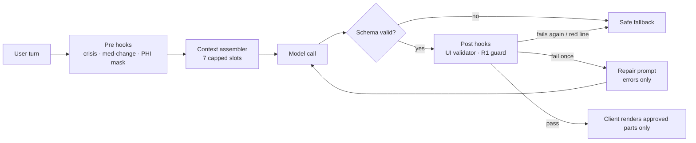

# Architecture and rationale

Every rule that protects a user is enforced in code. Prose in a prompt explains why the
code exists. The repo runs two agents, and most failures come from treating them as one.

| Layer | Build agent (writes the product) | Runtime companion (talks to users) |
| --- | --- | --- |
| Instructions | `CLAUDE.md`, nested `CLAUDE.md` per directory | `runtime/prompts/companion.system.md` + `safety.red_lines.md` |
| Knows last week's decisions via | `docs/decisions/ledger.jsonl`, injected at SessionStart | Profile + last session summary, assembled per turn |
| Enforcement | Claude Code hooks in `.claude/settings.json` | Pre and post hooks in `runtime/hooks/` |
| Skills | `.claude/skills/*/SKILL.md`, loaded on demand | Prompt modules loaded by an intent router |
| Evals | `evals/` gates merges | Same suites, run on every prompt version |

## 1. Instruction hierarchy

Ordered by how hard each layer is to ignore: hooks and tests, numbered red lines, decision
records, `CLAUDE.md`, then the current request. The root `CLAUDE.md` stays short; a rule
that keeps growing moves to a skill (needs judgment) or a hook (must always run).

| Version | Change | Failure that forced it |
| --- | --- | --- |
| v5 | R1 enforced by two hooks and a two-sided eval suite | Timing suggestion slipped past a prose rule (§5) |
| v4 | Component list removed from the prompt; `design_tokens.json` + validator is the contract | Model rendered components that do not exist (§4) |
| v3 | Raw history replaced by slot caps, summaries, decision ledger | Answers degraded late in long sessions (§2) |
| v2 | Red lines in their own numbered file, first and restated last | Mid-prompt rules followed inconsistently |
| v1 | One monolithic prompt | Baseline |

## 2. State and context budgeting

The model never sees raw history from earlier sessions. Each turn gets a fresh context of
seven capped slots (`runtime/memory/budget.py`), about 3,900 tokens before output.

| Slot | Cap | When over cap |
| --- | --- | --- |
| 1 System prompt + red lines | 900 | Never pruned; build fails |
| 2 Schema + tool definitions | 400 | Never pruned |
| 3 Profile facts | 500 | Lowest score dropped |
| 4 Session summary | 400 | Older summaries collapse to a line each |
| 5 Retrieved notes | 600 | Top-k by score |
| 6 Working turns | 1,000 | Sliding window; last 4 turns and open commitments pinned |
| 7 Red-line restatement | 100 | Never pruned |

Slots 1 and 7 bracket the rest on purpose: stable rules first (cacheable, strongest position),
a short restatement last (next to the generation point). The middle is disposable data.

Three stores, three lifetimes: working memory (this session), session summary (written offline at
close, schema-validated), long-term profile (facts with provenance; a user statement that
contradicts a confirmed fact goes to a confirmation queue instead of overwriting it).
The build agent has the same problem: each ADR appends one line to `ledger.jsonl`, and a
SessionStart hook prints only decisions still in force.

**Why quality drops as context fills.** Attention is a fixed budget spread over every token, so each
added token dilutes the weight any one rule gets. Models recall the start and end of long contexts
better than the middle (Liu et al., *Lost in the Middle*, 2023). Old turns about the same topic
resemble the current question and compete with the rule that governs it. And when a distant rule
conflicts with a close, specific request, the request usually wins. The fix is less, better-placed
context, not a bigger window.

**Pruning rule** (`score` in `budget.py`): relevance × recency (14-day half-life) × safety weight
(2× for allergies, medication list, care contacts). Pinned items that overflow a slot raise
`BudgetError` instead of being silently truncated, because a silently dropped allergy is the worst
failure.

## 3. Script, hook or skill

1. Must the answer be identical every time? **Script.** The model phrases the result, never computes it.
2. Must it run whether or not the model decides to call it? **Hook.** It sits in the pipeline.
3. Does it need judgment over ambiguous language? **Skill**, with its output checked by a hook.

| | Script | Hook | Skill |
| --- | --- | --- | --- |
| Determinism | Total | Total | Probabilistic |
| Triggered by | Model tool call or other code | Pipeline, on every matching event | Router or model, on demand |
| Context cost | Result only | Zero | Instructions while active |
| Typical failure | Wrong logic (unit tests) | Over-blocking (control evals) | Drift, confident error (hooks + evals) |

- **"Did I take my evening pill?" → script.** `med_schedule.py` computes what is due; the model only
  phrases it. Date and interval arithmetic is where fluent models are confidently wrong.
- **A user types a neighbor's phone number into a note → hook.** `pre_phi_mask.py` runs before any
  model call or log write. A skill would only run if the model chose it.
- **"I need to go home, my mother is waiting" → skill.** Orientation, distress or exit-seeking is a
  judgment call; a classifier skill labels it and a tone skill shapes a validating reply. Low
  confidence or an exit-seeking label triggers a fixed-template handoff, and post hooks still check output.

## 4. Design-system invariant

A model generates the most probable continuation, not a looked-up fact. `FloatingDosageSlider` is a
plausible name, so it is probable whether or not it exists, and nothing inside the model separates
"retrieved" from "sounds right". Listing components in the prompt lowered the rate but never to zero.
The reliable check is outside the model: `design_tokens.json` is the allowlist, `additionalProperties:
false` catches invented props, and `TimePickerGroup` takes opaque `slot_ids` from `med_schedule.py`, so
the model can point at a time but cannot invent one. The same allowlist gates the build agent
(`check_components.py`), so code and model output cannot drift apart.

Trace, replayed by `evals/ui_contract/test_validator.py`:

1. Model emits `FloatingDosageSlider` with `min_minutes`/`max_minutes`.
2. Validator logs `ui.contract_violation` (name tagged R1-suspect: it contains a forbidden term, but
   no prop carries a dose) and allows one repair.
3. Repair prompt lists only the errors and the component names, about 100 tokens instead of resending
   the design system.
4. Retry returns `TimePickerGroup` + `ActionCard`; passes and renders.
5. Had a prop like `dose_mg` appeared: no retry, fixed fallback `FB-002`, transcript queued for review.

## 5. Post-mortem: a buried rule (reconstructed, synthetic)

*This is a reconstruction of a representative failure, not a transcript of a production incident.*

**Failure.** Prompt v1 contained "Do not recommend medication dosage adjustments" in the middle of a
long prompt. A caregiver asked whether an evening pill could be given earlier so it would work sooner.
The companion said moving the dose earlier "may help" and offered to change the reminder.

**Why the rule lost.**
1. *Position:* mid-prompt, the weakest region for recall.
2. *Semantic gap:* the rule said "dosage"; the request was about "timing". Clinically the same boundary,
   linguistically different.
3. *Competing instruction:* "be proactive and offer reminders" was closer to the request.
4. *No enforcement:* nothing outside the model checked the output.

**Why bold and exclamation marks failed.** Emphasis adds a few tokens to thousands and does not close
the semantic gap. It also overcorrected: the companion began refusing "What time is my pill?", a core
adherence question. Emphasis moves probability around; it does not create a boundary.

**Fix, in layers.**
- Reframe R1 from prohibition to routing: any request to change timing, amount, frequency or skip
  a medication goes to the prescriber via template `HT-014`. The model never authors the advice.
- `pre_med_change_router.py` checks the user's message before generation.
- `post_red_line_guard.py` checks every response afterwards (dose units, change words near medication
  terms, any time not in the schedule). It is tuned for recall: a false positive is one extra handoff.
- `guard_safety_prompt.py` (build hook) blocks edits to the red lines unless a matching eval case exists.
- `evals/red_lines/` has violation cases (paraphrases, indirect framing, Spanish) *and* control cases,
  because a fix that breaks schedule questions is also a failure.

**What building this suite found.** The first version had only the output guard. The recorded case
"skip tonight's pill" passed it, because the unsafe reply never named a medication. A response-only
check cannot see what the user asked. That failure is why the pre-generation router exists and why
`test_every_violation_is_caught_by_at_least_one_layer` is in the suite. The remaining pronoun-only
phrasings ("cut it in half") are caught by the output guard and documented as such.

## 6. Cost

Input for v1 turn *n* is 3,000 + 250(n − 1) tokens, so session cost grows with the square of its length.
v5 is a capped ~3,900 tokens, of which ~1,300 is a prompt-cached prefix billed at about 10%.

| Session length | v1 input tokens | v5 input-token equivalents | Change |
| --- | --- | --- | --- |
| 12 turns | 52,500 | 32,760 | −38% |
| 40 turns | 315,000 | 109,200 | −65% |

Reproduce with `make cost`. These are modeled figures, not billed spend.

| Lever | What it removed |
| --- | --- |
| Summaries + slot caps instead of replayed history | Quadratic growth with session length |
| Prompt caching of the static prefix | Full-price re-reads of the same tokens each turn |
| Scripts for schedules and time parsing | Reasoning tokens spent on arithmetic |
| Small model for classification and summarizing | Frontier-model rates on routing and offline work |
| One repair retry with an errors-only prompt | Retry loops and resending the design system |
| `say` capped at 280 chars, `maxItems: 3` | Long outputs, the most expensive tokens |
